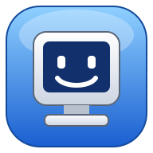
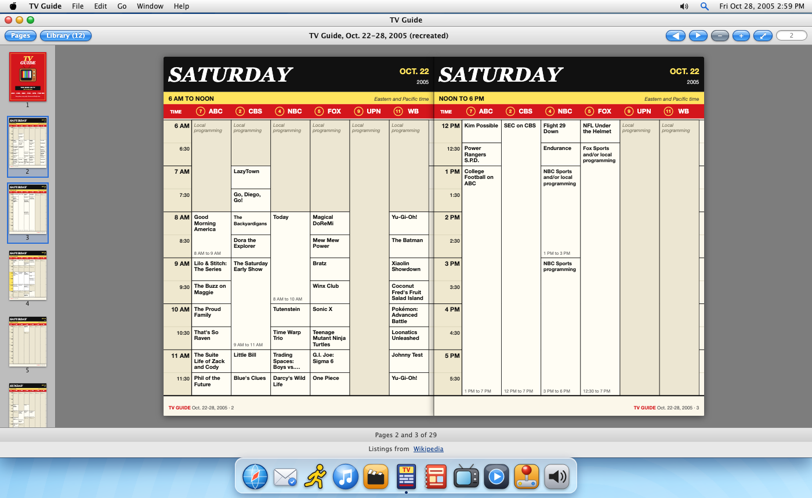
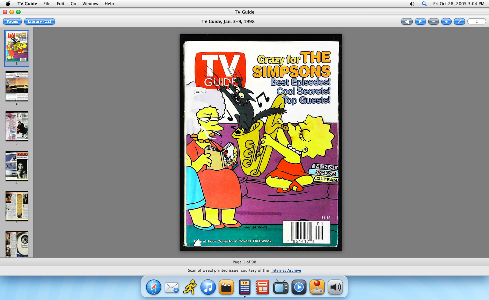
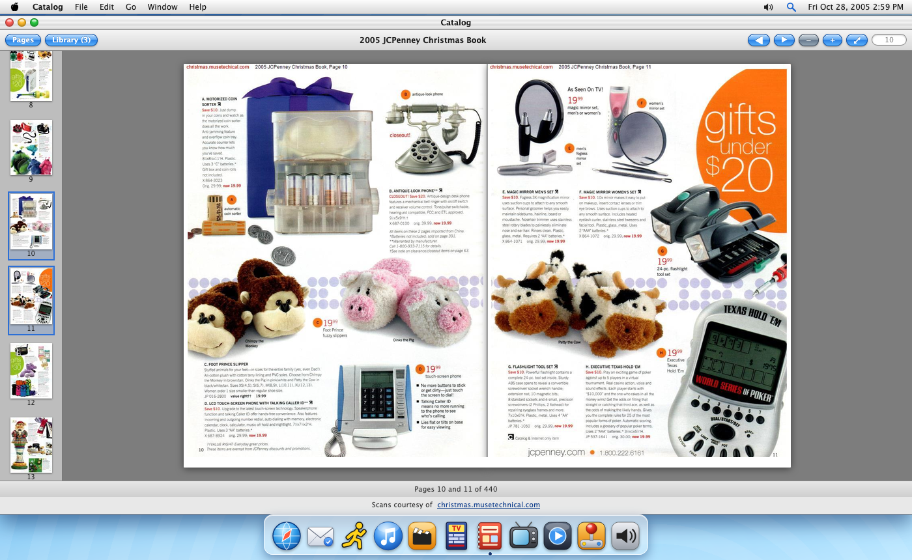
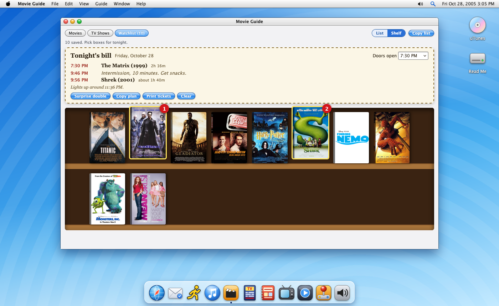
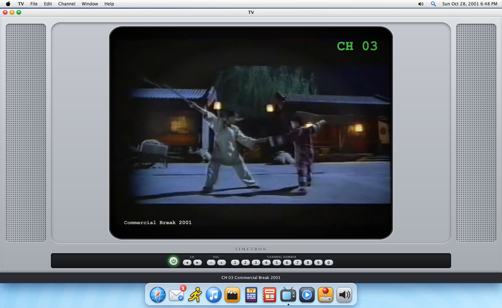

<h1 align="center">Nostalgia Desktop</h1>

<b>A computer from 1996 to 2005, running in your browser.</b>

Set the date and the machine fills with the real music, movies, TV shows and websites of that moment. It looks like an early-2000s Mac desktop, with a dock, a menu bar, a buddy list, a screen saver and a very slow modem. Everything in it is from 1996 to 2005, and nothing newer ever appears.

**Live demo:** https://hertn.github.io/nostalgia-desktop/

## Screenshots

<b><a href="https://hertn.github.io/nostalgia-desktop/gallery.html">Browse the full gallery (14 pictures)</a></b>

<table>
  <tr>
    <td width="50%" align="center" valign="top"> <b>TV Guide</b>, listings rebuilt as printed pages</td>
    <td width="50%" align="center" valign="top"> <b>TV Guide</b>, scans of real issues</td>
  </tr>
  <tr>
    <td width="50%" align="center" valign="top"> <b>Catalog</b>, real scanned spreads</td>
    <td width="50%" align="center" valign="top"> <b>Movie Night</b>, your watchlist on a shelf</td>
  </tr>
  <tr>
    <td width="50%" align="center" valign="top"> <b>TV</b>, real recordings of the era</td>
    <td width="50%" align="center" valign="top"> <b>TV</b>, maximized</td>
  </tr>
  <tr>
    <td width="50%" align="center" valign="top"> <b>Old Web</b>, opening on the day on your clock</td>
    <td width="50%" align="center" valign="top"> <b>NIM</b>, chat rooms and profiles</td>
  </tr>
</table>

## Why it exists

For anyone who misses the early internet. It is a time capsule to look around in, a place to find something to watch or listen to, and a way to chat with other people who remember.

**Why 1996 to 2005?** Those are the years I spent in school growing up in Estonia, where basic school runs from grade 1 to grade 9 (roughly ages 7 to 16). That makes them the most nostalgic years of my life. The content leans American (Billboard charts, US TV, US catalogs) because that is what reached me through a screen back then. If you are used to the US system, think of it as "from first grade until about the start of high school".

## What is inside

| App | What it does |
| --- | --- |
| **Movie Guide** | Don't know what to watch? Open it and find something. Browse movies and TV shows from the era, filter by year, genre or network, press the **Surprise me** button for a random pick, or press the **Movie Night** button to get a double feature. Save favorites to a watchlist, then switch it to the **Shelf**: your saved titles stand on a video store shelf, and clicking boxes builds tonight's bill with start times, an intermission and when the lights come up, ready to copy or print. |
| **uTunes** | The Billboard Year-End Hot 100 for every year, with the music videos. Build a playlist, then send it to Spotify or Apple Music (see below). |
| **TV** | An old TV with ten channels of real recordings from the year on your clock: news (from the exact date), Saturday morning cartoons, commercials, kids TV, cartoons, sitcoms, dramas, late night, music TV, and sports and movies. Type a channel on the keypad or keyboard, or use the arrow keys. Press F for full screen. |
| **Old Web** | Real websites as the Internet Archive saved them near your date. It opens on an "On this day" page with headlines, the number one song and movie, what was on TV and a picture of the day, and it dials in with a modem the first time. |
| **TV Guide** | The printed TV listings, in the same page-flipping viewer as the Catalog. It opens the week on your clock as a recreated magazine: four pages for every day of what ABC, CBS, NBC, Fox, UPN and The WB ran, with the prime time hours in yellow. The Library also holds the real TV Guide issues that survive online as scans (1997 to 2002), and one opens by itself when its week matches your clock. |
| **Catalog** | The real printed JCPenney and Sears catalogs of the year on your clock, as page scans you flip through like a book: every book of the year on your clock, opening on the one for the current quarter (Spring and Summer from January to June, Fall and Winter from July to September, Christmas from October to December). Click the sides or drag to turn pages, zoom in, jump with the page sidebar, open the **Library** for the older books of that year, or press **F** for true full screen. |
| **Mail** | Email coming in, with true-to-era messages: chain letters, forwards, notes from friends and a daily digest of your date. Each one arrives with a chime and a spoken announcement. The **Settings** button sets how often. |
| **NIM** (Nostalgia IM) | A buddy list, instant messages, public chat rooms and profiles, with the sounds you remember. |
| **Arcade** | Snake on a phone screen, Minefield, Blockfall (Tetris-style), and a Tamagotchi-style virtual pet, a dog or cat that keeps living while the page is closed. |
| **QuickShow** | A small player for trailers and TV openings. |
| **Sounds** | Pick your own sounds for each event. |

Click the clock in the menu bar to travel to any day. By default the machine starts on today's month and day, in 2005. There are also four screen savers, a right-click menu almost everywhere, a dock you can rearrange, Spotlight search, a start-up screen and a shut-down animation.

## Send your playlist to Spotify or Apple Music

1. In **uTunes**, add songs to My Playlist with the **+** button, then open My Playlist.
2. Press the **Export** button, then the **Download CSV** button (or **Copy as text**).
3. Upload the file to a playlist converter such as [TuneMyMusic](https://www.tunemymusic.com/) or [Soundiiz](https://soundiiz.com/), choose Spotify or Apple Music, and sign in there.

The converter matches each song and builds the playlist for you. Matching is not perfect, so check the result. Those sites are independent of this one, and this page never sees your Spotify or Apple login.

## How it works

It is plain HTML, CSS and JavaScript (ES modules) with no build step, no server and no accounts, and it runs on GitHub Pages. Everything is looked up live, without API keys, and cached in your browser:

- **Music charts:** Wikipedia
- **Movies and TV:** Wikidata, with plot summaries and posters from Wikipedia
- **"On this day":** Wikipedia date pages and current events, with Wikimedia Commons pictures of the day
- **Videos:** found through public Piped search instances and played in YouTube's embedded player (videos that disallow embedding are skipped)
- **Old websites:** the Internet Archive's Wayback Machine
- **TV recordings:** the Internet Archive's video collections (VHS tapes of real broadcasts, commercial reels, news, cartoons), streamed straight from archive.org into a video player
- **Catalog pages:** scans from [christmas.musetechnical.com](https://christmas.musetechnical.com/), loaded straight from your browser to their server (their server only handles two requests at a time, so new pages take a moment; pages you have seen are kept in your browser)

### Chat

Visitors connect directly to each other with WebRTC, and [Trystero](https://github.com/dmotz/trystero) finds peers through public relays. Messages are never stored. If nobody else is online, you will see a few clearly labeled bots instead. Chat is not moderated, so each conversation has a **Block** button.

## Good to know

- It works best in Safari or Chrome. Some Firefox versions struggle with embedded YouTube videos.
- Some networks block WebRTC, so chat shows only the bots there.
- Archived websites load slowly and are often missing pictures or links.
- Catalog pages come from someone else's small server, so a page you have not seen can take a second or two. If the catalog does not load, that server is busy or offline.
- Browsers only allow sound after you click something, and the spoken mail announcement uses your browser's own voice, so it differs from computer to computer.
- Your pet, inbox, playlist, scores and settings are stored in your browser only.

## Run it locally

    git clone https://github.com/hertn/nostalgia-desktop.git
    cd nostalgia-desktop
    python3 -m http.server 8765

Then open http://localhost:8765. YouTube embeds need `http(s)`, so opening `index.html` straight from disk will not play video. To see real chat, open two tabs and sign on to NIM with different names.

## Project layout

    index.html        the windows and markup
    logo.svg          the logo from the start-up screen
    css/style.css     all styling
    js/main.js        the desktop, apps, chat, TV, Old Web and menus
    js/data.js        the live data lookups
    CHANGELOG.md      what changed and when
    js/arcade.js      the games
    js/mail.js        the inbox
    js/catalog.js     the page viewer shared by Catalog and TV Guide (flipping, zoom, full screen)
    js/tvguide.js     the TV Guide books (recreated listing pages, real TV Guide scans)
    js/tvsched.js     reads Wikipedia's TV schedule tables into plain data
    js/savers.js      the screen savers
    gallery.html      screenshot gallery (thumbnail grid with lightbox)

## Credits

Built by Claude, an AI made by Anthropic, and directed by Hert Niks.

Chat uses [Trystero](https://github.com/dmotz/trystero) (MIT). Wikipedia text is available under CC BY-SA and is read live, not copied into this repository.

The catalog pages are scans of real printed JCPenney and Sears catalogs, hosted by [christmas.musetechnical.com](https://christmas.musetechnical.com/) and shown here by linking to them, not copied into this repository. This is a fan tribute. The TV plays recordings from the Internet Archive, streamed from archive.org and not copied into this repository; the TV screenshots show a frame from a 2001 commercial on the Archive. Apart from those scans and recordings, names, marks, icons and sounds are original or generated in the browser. It has no connection to any real company or service, and its own logos and interface use none of theirs.

## Support

Nostalgia Desktop is free, with no ads. If you enjoy it, you can [buy me a coffee on Ko-fi](https://ko-fi.com/hertn).

## License

MIT. See `LICENSE`.
