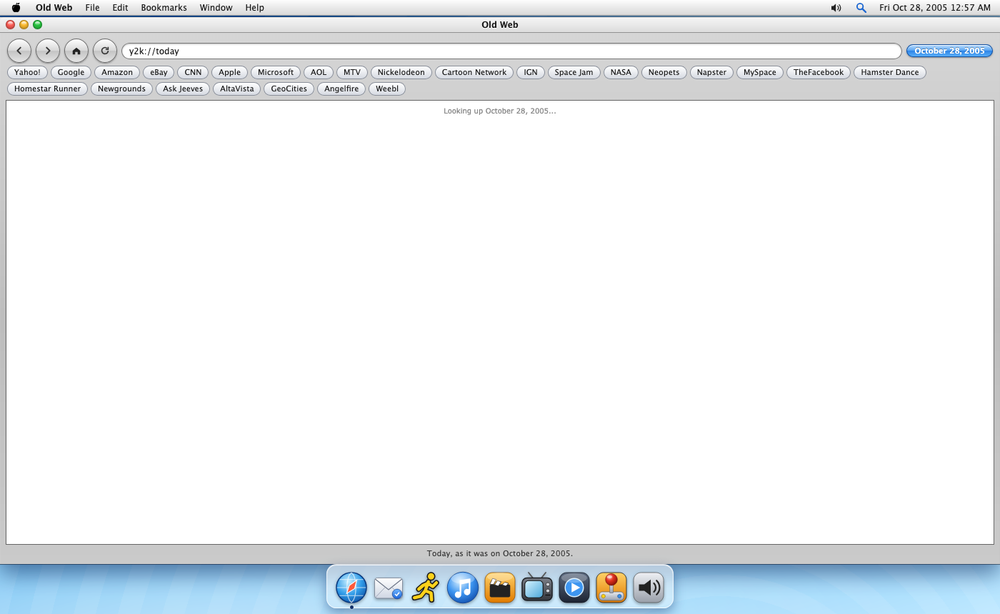
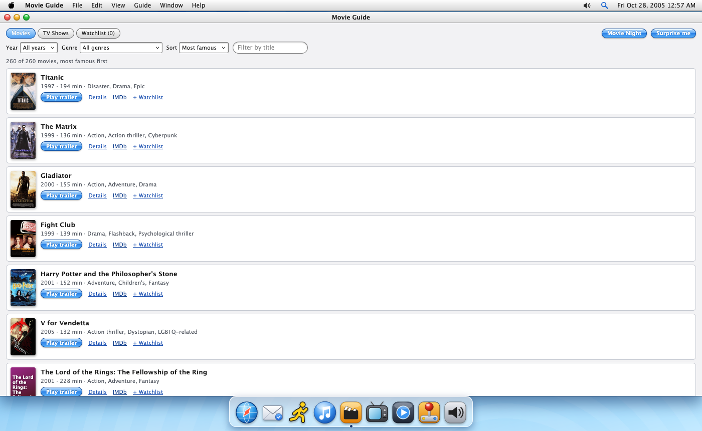
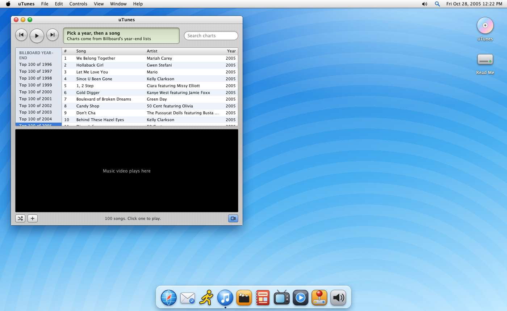
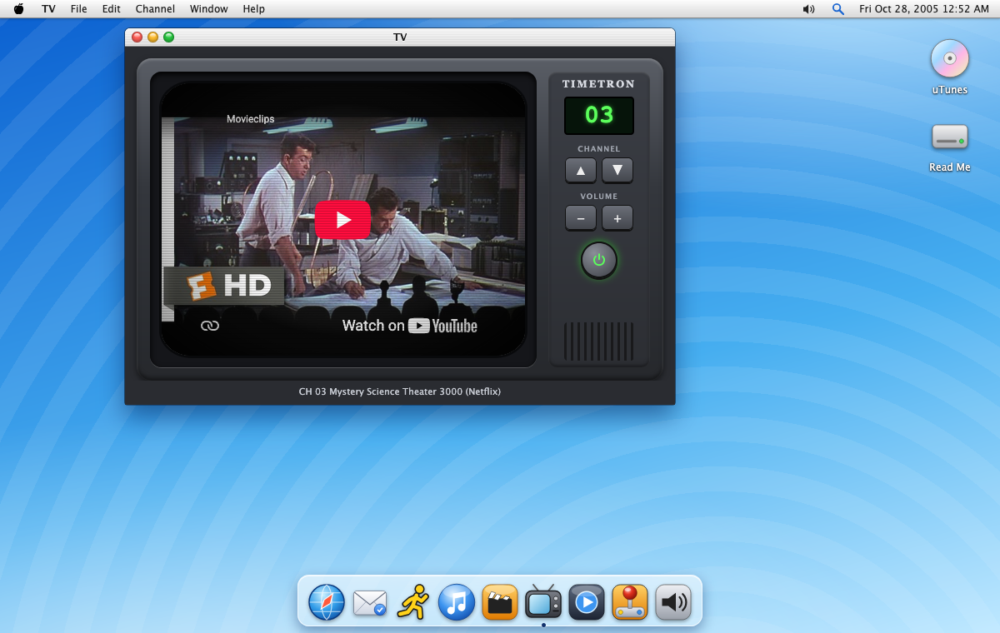
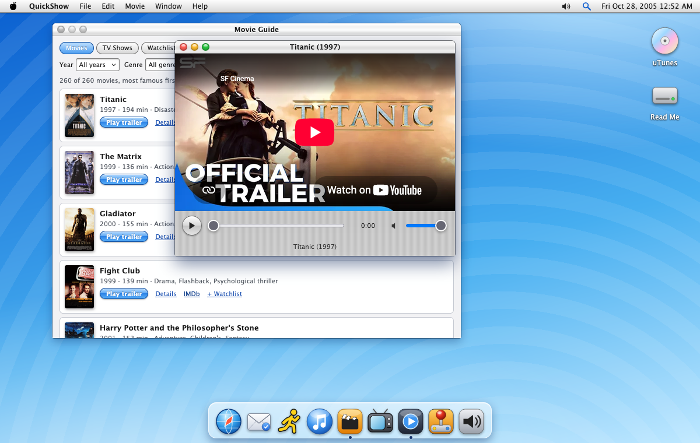
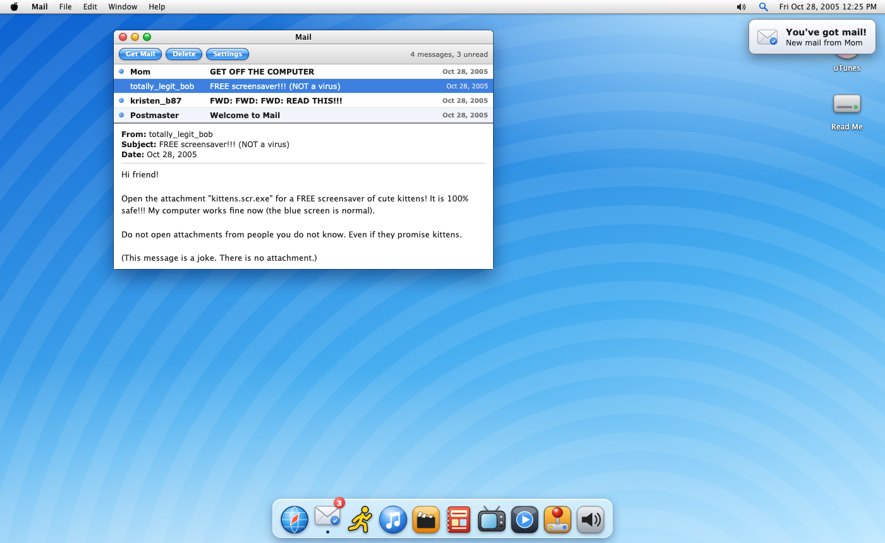
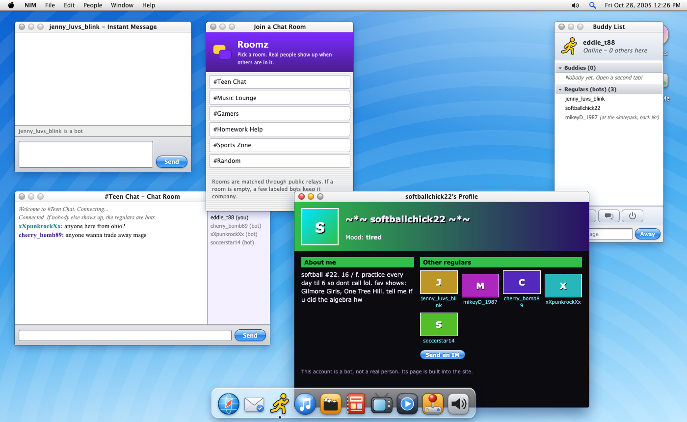
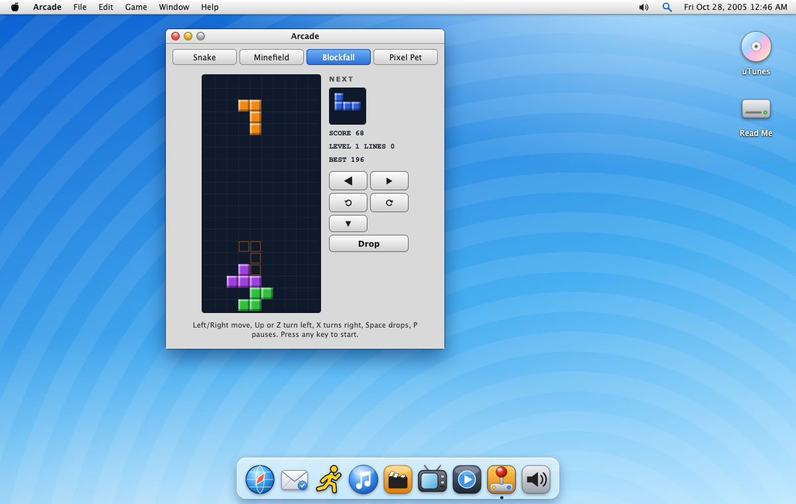

# Nostalgia Machine

**A computer from 1996 to 2005, running in your browser.**

Set the date and the machine fills with the real music, movies, TV shows and websites of that moment. It looks like an early-2000s Mac desktop, with a dock, a menu bar, a buddy list, a screen saver and a very slow modem. Everything in it is from 1996 to 2005, and nothing newer ever appears.

**Live demo:** https://hertn.github.io/nostalgia-machine/

## Screenshots

<table>
  <tr>
    <td width="50%" align="center" valign="top"> <b>Old Web</b>, opening on "On this day"</td>
    <td width="50%" align="center" valign="top"> <b>Movie Guide</b>: open it and find something</td>
  </tr>
  <tr>
    <td width="50%" align="center" valign="top"> <b>uTunes</b>, with the 2005 chart</td>
    <td width="50%" align="center" valign="top"> <b>TV</b>, channel 3</td>
  </tr>
  <tr>
    <td width="50%" align="center" valign="top"> <b>QuickShow</b>, playing a trailer</td>
    <td width="50%" align="center" valign="top"> <b>Mail</b>, with a new message arriving</td>
  </tr>
  <tr>
    <td width="50%" align="center" valign="top"> <b>NIM</b>, chat rooms and profiles</td>
    <td width="50%" align="center" valign="top"> <b>Arcade</b>, playing Blockfall</td>
  </tr>
</table>

## Why it exists

For anyone who misses the early internet. It is a time capsule to look around in, a place to find something to watch or listen to, and a way to chat with other people who remember.

## What is inside

| App | What it does |
| --- | --- |
| **Movie Guide** | Don't know what to watch? Open it and find something. Browse movies and TV shows from the era, filter by year, genre or network, press the **Surprise me** button for a random pick, or press the **Movie Night** button to get a double feature. Save favorites to a watchlist. |
| **uTunes** | The Billboard Year-End Hot 100 for every year, with the music videos. Build a playlist, then send it to Spotify or Apple Music (see below). |
| **TV** | An old TV with channels 1 to 69: shows from the era, an evening news channel from the exact date on your clock, commercials and Saturday morning cartoons. |
| **Old Web** | Real websites as the Internet Archive saved them near your date. It opens on an "On this day" page with headlines, the number one song and movie, what was on TV and a picture of the day, and it dials in with a modem the first time. |
| **Mail** | Email coming in, with true-to-era messages: chain letters, forwards, notes from friends and a daily digest of your date. Each one arrives with a chime and a spoken announcement. The **Settings** button sets how often. |
| **NIM** (Nostalgia IM) | A buddy list, instant messages, public chat rooms and profiles, with the sounds you remember. |
| **Arcade** | Snake on a phone screen, Minefield, Blockfall (Tetris-style), and a Tamagotchi-style virtual pet, a dog or cat that keeps living while the page is closed. |
| **QuickShow** | A small player for trailers and TV openings. |
| **Sounds** | Pick your own sounds for each event. |

Click the clock in the menu bar to travel to any day. By default the machine starts on today's month and day, in 2005. There are also four screen savers, a right-click menu almost everywhere, a dock you can rearrange, Spotlight search, a start-up screen and a shut-down animation.

## Send your playlist to Spotify or Apple Music

1. In **uTunes**, add songs to My Playlist with the **+** button, then open My Playlist.
2. Press the **Export** button, then the **Download CSV** button (or **Copy as text**).
3. Upload the file to a playlist converter such as [TuneMyMusic](https://www.tunemymusic.com/) or [Soundiiz](https://soundiiz.com/), choose Spotify or Apple Music, and sign in there.

The converter matches each song and builds the playlist for you. Matching is not perfect, so check the result. Those sites are independent of this one, and this page never sees your Spotify or Apple login.

## How it works

It is plain HTML, CSS and JavaScript (ES modules) with no build step, no server and no accounts, and it runs on GitHub Pages. Everything is looked up live, without API keys, and cached in your browser:

- **Music charts:** Wikipedia
- **Movies and TV:** Wikidata, with plot summaries and posters from Wikipedia
- **"On this day":** Wikipedia date pages and current events, with Wikimedia Commons pictures of the day
- **Videos:** found through public Piped search instances and played in YouTube's embedded player (videos that disallow embedding are skipped)
- **Old websites:** the Internet Archive's Wayback Machine

### Chat

Visitors connect directly to each other with WebRTC, and [Trystero](https://github.com/dmotz/trystero) finds peers through public relays. Messages are never stored. If nobody else is online, you will see a few clearly labeled bots instead. Chat is not moderated, so each conversation has a **Block** button.

## Good to know

- It works best in Safari or Chrome. Some Firefox versions struggle with embedded YouTube videos.
- Some networks block WebRTC, so chat shows only the bots there.
- Archived websites load slowly and are often missing pictures or links.
- Browsers only allow sound after you click something, and the spoken mail announcement uses your browser's own voice, so it differs from computer to computer.
- Your pet, inbox, playlist, scores and settings are stored in your browser only.

## Run it locally

    git clone https://github.com/hertn/nostalgia-machine.git
    cd nostalgia-machine
    python3 -m http.server 8765

Then open http://localhost:8765. YouTube embeds need `http(s)`, so opening `index.html` straight from disk will not play video. To see real chat, open two tabs and sign on to NIM with different names.

## Project layout

    index.html        the windows and markup
    css/style.css     all styling
    js/main.js        the desktop, apps, chat, TV, Old Web and menus
    js/data.js        the live data lookups
    js/arcade.js      the games
    js/mail.js        the inbox
    js/savers.js      the screen savers

## Credits

Built by Claude, an AI made by Anthropic, and directed by Hert Niks.

Chat uses [Trystero](https://github.com/dmotz/trystero) (MIT). Wikipedia text is available under CC BY-SA and is read live, not copied into this repository.

This is a fan tribute. Names, marks, icons and sounds are original or generated in the browser. It has no connection to any real company or service and uses none of their logos or recordings.

## License

MIT. See `LICENSE`.
